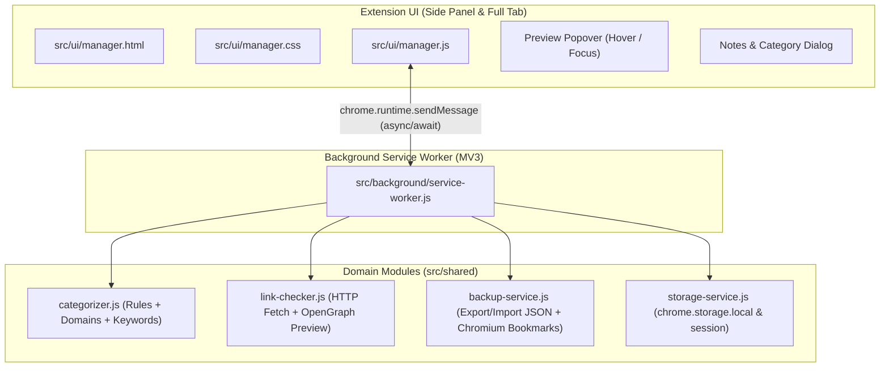

# Brave Bookmark Architect & Smart Organizer

A **Manifest V3** browser extension designed for **Brave Browser** and **Google Chrome** that scans all your bookmarks, validates every link, automatically categorizes and organizes them into folders on the **Bookmarks Bar**, displays a **rich preview on mouse hover**, lets you attach **observation notes** to each bookmark, and provides **Export / Import (Backup)** fully compatible with the native Brave/Chrome `Bookmarks` file.

## Project Architecture



## How to Install on Brave or Chrome

> **Important**: Chromium reserves filenames starting with `_` (such as `_docs` and `_testes` at the root of the repository) exclusively for `_locales` and `_metadata`. Therefore, the clean, ready-to-load extension package is isolated inside the **`extension/`** directory.

1. Open Brave (`brave://extensions`) or Chrome (`chrome://extensions`).
2. Enable **Developer mode** in the top-right corner.
3. Click **Load unpacked**.
4. Select the **`extension`** folder inside this project:
   `YOUR-FULL-PROJECT-PATH/bookmark_manager/extension`
5. Click the extension icon in your browser toolbar to open the **Side Panel** (or click the **⛶ Full Screen** button to open it in a full tab).

## How to Run Automated Tests

```bash
npm test
```

## 🤝 Contributing

Contributions are always welcome! Feel free to:

1. Report bugs
2. Suggest new features
3. Submit pull requests

## 📝 License

This project is licensed under the MIT License. See the [LICENSE](LICENSE) file for more details.

## ☕ Support the Project

If this project helped you in any way, consider making a donation:

[](https://ko-fi.com/E4I024A0VK)

**PIX**: `536c8d7e-fb28-444f-8d58-7fd87397d401`
