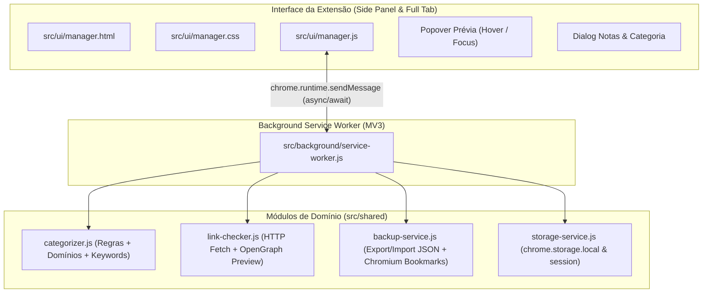

# Brave Bookmark Architect & Smart Organizer

Extensão **Manifest V3** desenvolvida para **Brave Browser** e **Google Chrome** que percorre todos os favoritos, testa a validade de cada link, categoriza e organiza automaticamente em pastas na **Barra de Favoritos**, exibe uma **prévia rica ao passar o mouse (hover)**, permite adicionar **notas de observação** por link e oferece **Exportação / Importação (Backup)** compatível inclusive com o arquivo `Bookmarks` nativo do Brave/Chrome.

## Arquitetura do Projeto



## Como Instalar no Brave ou Chrome

> **Importante**: O Chromium reserva nomes iniciados com `_` (como `_docs` e `_testes` na raiz do repositório) apenas para `_locales` e `_metadata`. Por isso, o pacote limpo da extensão fica isolado na pasta **`extension/`**.

1. Abra o navegador Brave (`brave://extensions`) ou Chrome (`chrome://extensions`).
2. Ative a chave **Modo do desenvolvedor** (*Developer mode*) no canto superior direito.
3. Clique em **Carregar sem compactação** (*Load unpacked*).
4. Selecione a pasta **`extension`** dentro deste projeto:
   `/home/murilo/Projetos/dev/tools/bookmark_manager/extension`
5. Clique no ícone da extensão na barra do navegador para abrir o **Side Panel** (ou clique no botão **⛶ Tela Cheia** para abrir como aba completa).

## Como Executar os Testes Automatizados

```bash
npm test
```

