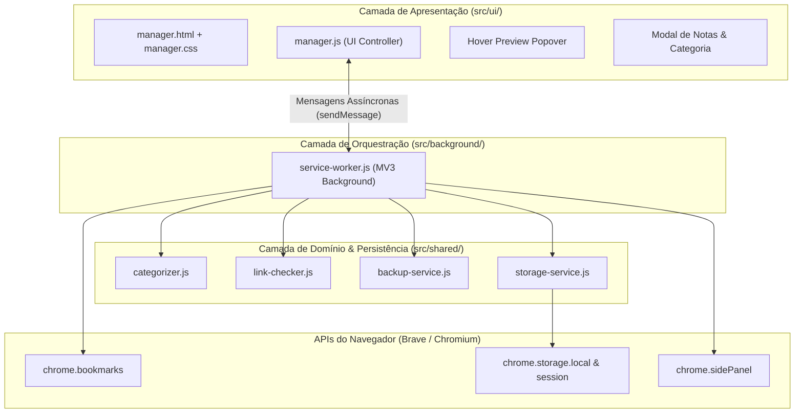

# PROJECT CHECKPOINT — Brave Bookmark Architect & Smart Organizer

**Data de Atualização:** 15/11/2026  
**Versão:** `1.0.0`  
**Status:** Funcional e Testado (Pronto para uso em Brave / Google Chrome)

---

## 1. Objetivo Geral e Escopo

O **Brave Bookmark Architect & Smart Organizer** é uma extensão de navegador (Manifest V3) projetada para o **Brave Browser** e **Google Chrome** com o objetivo de automatizar a auditoria, organização, anotação e backup de favoritos, tomando como referência a base real de **265 links** do arquivo `Bookmarks` do usuário.

### Escopo Principal
1. **Percorrer e Testar Links**: Validar assincronamente todos os favoritos do navegador, identificando links online (`200–399`), protegidos/login (`401/403/429`), quebrados/offline (`404/500+/DNS/Timeout`) e recursos locais/scripts (`javascript:`, `file://`).
2. **Categorizar e Organizar na Barra de Favoritos**: Classificar cada favorito por domínio, palavras-chave e contexto de pasta, criando as pastas correspondentes diretamente na **Barra de Favoritos (`id: "1"`)** e movendo os links automaticamente.
3. **Prévia ao Passar o Mouse (Hover Preview)**: Exibir um card flutuante acessível (`popover="hint"`) ao passar o mouse ou focar em qualquer favorito, apresentando título completo, descrição OpenGraph/meta, imagem de capa (`og:image`), status HTTP e a nota de observação do usuário.
4. **Notas de Observação por Link**: Permitir adicionar, editar e pesquisar anotações personalizadas vinculadas a cada URL, visíveis nos cards, na prévia e incluídas no backup.
5. **Exportação e Importação (Backup)**: Exportar todos os favoritos enriquecidos (categorias, notas, status e prévias) em JSON e importar tanto backups gerados pelo plugin quanto o próprio arquivo `Bookmarks` nativo do Brave/Chrome.

---

## 2. Arquitetura Escolhida e Justificativa

Foi adotada uma **Arquitetura Modular Orientada a Serviços para WebExtensions (Manifest V3)**, separando estritamente:
- **Camada de Domínio e Serviços Compartilhados (`src/shared/`)**: Módulos ES puros e desacoplados da DOM (`categorizer.js`, `link-checker.js`, `backup-service.js`, `storage-service.js`), permitindo execução tanto no Service Worker quanto em testes automatizados via Node.js.
- **Camada de Orquestração em Background (`src/background/service-worker.js`)**: Service Worker efêmero que gerencia as chamadas privilegiadas às APIs `chrome.bookmarks`, `chrome.storage`, `chrome.sidePanel`, `chrome.contextMenus` e `chrome.notifications`.
- **Camada de Apresentação (`src/ui/`)**: Interface híbrida que funciona tanto no **Side Panel** nativo do Brave/Chrome quanto em uma aba de **Tela Cheia**, utilizando APIs HTML modernas (`<dialog closedby="any">`, `<div popover="hint">`) sem dependências externas pesadas.



**Justificativa:**
- **Zero Build-Step / Zero Dependências de Runtime**: Pode ser carregada imediatamente em `brave://extensions` (*Load unpacked*) sem exigir bundlers complexos, reduzindo superfície de ataque (Supply Chain Security) e facilitando manutenção.
- **Resiliência ao Ciclo de Vida Efêmero do MV3**: Nenhum estado crítico fica em variáveis globais de memória no Service Worker; o estado de varredura usa `chrome.storage.session` e os metadados permanentes usam `chrome.storage.local`.

---

## 3. Tecnologias e Versões Principais

| Camada | Tecnologia | Versão / Padrão |
| :--- | :--- | :--- |
| Plataforma de Extensão | Chrome / Brave Extensions | **Manifest V3** |
| Linguagem | JavaScript (ES Modules) | **ES2023+** |
| Interface & Componentes | HTML5 Nativo (`<dialog closedby="any">`, `popover="hint"`) + CSS3 Custom Properties | Baseline 2025/2026 + Fallbacks |
| Armazenamento | `chrome.storage.local` (10 MB) & `chrome.storage.session` | API Nativa MV3 |
| Testes Automatizados | Node.js Test Runner (`node:test` + `node:assert/strict`) | Node.js v20+ |
| Geração de Ativos | Python 3 + Pillow (PIL) | PNG 16x16, 48x48, 128x128 |

---

## 4. Estrutura de Pastas Atual

> **Decisão Técnica Importante (Isolamento da pasta `extension/`)**: O empacotador de extensões do Chromium/Brave proíbe qualquer arquivo ou pasta iniciado com `_` (exceto `_locales` e `_metadata`) dentro do diretório onde está o `manifest.json`. Para manter as pastas obrigatórias `_docs/` e `_testes/` na raiz do projeto sem conflito com o carregador do Brave, todo o código carregável da extensão fica isolado em `extension/`.

```text
/home/murilo/Projetos/dev/tools/bookmark_manager/
├── Bookmarks                             # Arquivo original de referência do Brave/Chrome (265 links)
├── package.json                          # Configuração ES Module e script de teste
├── README.md                             # Instruções de instalação e visão geral
├── _docs/
│   └── PROJECT_CHECKPOINT.md             # Este documento de checkpoint arquitetural
├── _testes/
│   └── unit/
│       └── bookmark-architect.test.js    # Suíte de testes unitários e de integração com o arquivo Bookmarks
└── extension/                            # <-- PASTA PARA CARREGAR NO BRAVE (brave://extensions)
    ├── manifest.json                     # Manifesto MV3 da extensão
    ├── icons/
    │   ├── icon-16.png                   # Ícone 16x16px
    │   ├── icon-48.png                   # Ícone 48x48px
    │   └── icon-128.png                  # Ícone 128x128px
    └── src/
        ├── background/
        │   └── service-worker.js         # Orquestrador de background (Scan, Organização na Barra, Backup)
        ├── shared/
        │   ├── backup-service.js         # Serialização, exportação e importação (JSON e Chromium Bookmarks)
        │   ├── categorizer.js            # Motor de regras de categorização por domínio, pasta e keywords
        │   ├── link-checker.js           # Validador HTTP concorrente + extrator de metadados OpenGraph
        │   └── storage-service.js        # Abstração de persistência em chrome.storage
        └── ui/
            ├── manager.css               # Estilização Dark Mode inspirada no Brave Browser
            ├── manager.html              # Estrutura HTML do Side Panel / Dashboard
            └── manager.js                # Controlador da interface, filtros, hover preview e modais
```

---

## 5. Funcionalidades Implementadas

- [x] **Leitura e Enriquecimento da Árvore de Favoritos**: Percorre recursivamente `Barra de favoritos`, `Outros favoritos` e subpastas.
- [x] **Validação Concorrente de Links (`link-checker.js`)**:
  - Pool de 6 *workers* simultâneos com timeout de 8 segundos via `AbortController`.
  - Leitura parcial de stream (máximo de 48 KB ou até `</head>`) para não baixar páginas ou arquivos gigantes inteiros.
  - Detecção inteligente de páginas que retornam HTTP 200 de um proxy mas trazem `502 Bad Gateway` ou `404 Not Found` no `<title>`.
- [x] **Categorização Automática Calibrada (`categorizer.js`)**:
  - 13 categorias principais mapeadas a partir dos 265 links reais: `AI`, `Programação`, `Dev`, `APIs`, `Documentação`, `GameAssets`, `Vendas`, `Edição`, `Cripto`, `TesteInternet`, `Estudo`, `Governo & Utilidades` e `Geral`.
  - Unificação de pastas duplicadas (ex.: `IAs` e `AI` convergem para `AI`).
  - Correção de anomalias (ex.: sites governamentais/utilidades que estavam salvos dentro da pasta `AI` são reclassificados para `Governo & Utilidades`).
- [x] **Organização Automática na Barra de Favoritos (`service-worker.js`)**:
  - Cria as pastas de categoria diretamente em `parentId: "1"` (Barra de Favoritos).
  - Move cada favorito para sua pasta correspondente.
  - Opção de isolar links quebrados em uma pasta `⚠️ Links Quebrados`.
  - Remove automaticamente subpastas antigas que ficaram vazias após a reorganização.
- [x] **Prévia ao Passar o Mouse (`manager.js` + `manager.html`)**:
  - Exibe título completo, domínio, badge de status HTTP, imagem `og:image`, descrição da página e a nota do usuário.
  - Caso o usuário passe o mouse sobre um link ainda não verificado, realiza a inspeção em tempo real (*lazy live preview*).
- [x] **Sistema de Notas de Observação e Categorias Customizadas**:
  - Modal de edição com suporte a criação de novas categorias e movimentação imediata na Barra de Favoritos.
- [x] **Exportação e Importação de Backup (`backup-service.js`)**:
  - Exporta arquivo `bookmarks-backup-YYYY-MM-DD.json` contendo árvore completa + notas + categorias + status/prévias.
  - Importa tanto o JSON de backup do plugin quanto o arquivo `Bookmarks` nativo do Brave/Chrome sem duplicar URLs já existentes.

---

## 6. Modelos de Dados (Schema Resumido)

### 6.1. `chrome.storage.local` (`bm_metadata_by_url`)
Indexado pela URL normalizada para garantir que notas e categorias persistam mesmo quando o favorito é movido de pasta ou reimportado:

```json
{
  "https://www.agensi.io/": {
    "category": "AI",
    "note": "Marketplace de skills para agentes de IA",
    "status": "valid",
    "statusCode": 200,
    "error": null,
    "preview": {
      "pageTitle": "Agensi: The Skill Marketplace for AI Agents",
      "description": "Discover and integrate specialized skills for autonomous AI agents.",
      "image": "https://www.agensi.io/og-image.png"
    },
    "checkedAt": "2026-11-15T18:30:00.000Z",
    "updatedAt": "2026-11-15T18:35:00.000Z"
  }
}
```

### 6.2. `chrome.storage.session` (`bm_scan_state`)
Armazena o estado transitório da varredura em lote para sobreviver à hibernação do Service Worker:

```json
{
  "status": "scanning",
  "completed": 120,
  "total": 265,
  "startedAt": "2026-11-15T18:29:00.000Z"
}
```

---

## 7. Regras de Negócio Importantes

1. **Chaveamento por URL Normalizada**: As notas de observação e categorias são vinculadas à URL (e não apenas ao `id` interno do Chromium, que muda se o favorito for recriado ou importado em outro computador).
2. **Prioridade de Categorização**:
   - 1º: Categoria definida manualmente pelo usuário no modal de edição.
   - 2º: Esquemas especiais (`javascript:`, `file://`, `localhost`) → `Dev`.
   - 3º: Correspondência exata ou de subdomínio na tabela `CATEGORY_RULES`.
   - 4º: Preservação/normalização da pasta atual caso já seja uma categoria válida.
   - 5º: Palavras-chave no título ou caminho da URL.
   - 6º: Fallback para `Geral`.
3. **Diferenciação entre Links Quebrados e Links Protegidos**: Respostas HTTP `401`, `403`, `405` e `429` são classificadas como `restricted` (Protegido / Login / Anti-bot) e **não** são movidas para a quarentena de links quebrados, evitando falsos positivos em dashboards privados (ex.: AWS Console, Stripe Dashboard, Mercado Pago Developers).

---

## 8. Decisões Técnicas Relevantes

- **Extração de Metadados por Stream Parcial no Service Worker**: Como Service Workers no Manifest V3 não possuem `DOMParser` nativo e páginas podem ter vários megabytes, o `link-checker.js` utiliza `ReadableStreamDefaultReader` para ler no máximo os primeiros 48 KB (ou até o fechamento da tag `</head>`), cancelando o restante do download imediatamente. Isso reduz drasticamente o consumo de banda e memória.
- **Conformidade com WCAG 1.4.13 no Popover de Prévia**: O card de prévia utiliza `popover="hint"` combinado com temporizadores de *hover intent* (220ms para abrir, 240ms para fechar permitindo que o mouse transite do link para dentro do card de prévia sem fechá-lo) e fechamento imediato com a tecla `Esc`.
- **Light-Dismiss Declarativo com Fallback**: O modal `<dialog id="noteEditDialog" closedby="any">` inclui o fallback programático via `getBoundingClientRect()` para garantir fechamento ao clicar fora do modal em qualquer versão do Chromium.

---

## 9. Status de Segurança e Performance

- **Segurança (OWASP & Extension CSP)**:
  - Nenhum uso de `innerHTML` com dados externos: toda renderização de títulos, URLs, descrições OpenGraph e notas de usuário utiliza `textContent` e criação segura de nós DOM (`document.createElement`), prevenindo totalmente ataques de **Cross-Site Scripting (XSS)** vindos de páginas maliciosas inspecionadas.
  - Requisições de verificação de links usam `credentials: 'omit'` e `cache: 'no-store'`, evitando vazamento de cookies de sessão durante o *ping* em lote.
  - Nenhum dado é enviado para servidores externos; 100% do processamento e armazenamento ocorre localmente no navegador do usuário (total conformidade com **LGPD / GDPR**).
- **Performance**:
  - Varredura controlada com concorrência máxima de 6 conexões simultâneas e persistência em lotes (`batchUpdateMetadata` a cada 8 itens), evitando bloqueio da thread de UI ou estrangulamento de I/O no `chrome.storage`.

---

## 10. Próximos Passos Sugeridos

1. **Detecção de Duplicatas com Merge de Notas**: Adicionar uma visão dedicada para listar URLs similares (ignorando parâmetros de tracking como `utm_source`, `gad_source`, `gbraid` presentes em alguns links do arquivo `Bookmarks`) e permitir mesclá-las com um clique.
2. **Agendamento Automático Opcional (`chrome.alarms`)**: Permitir configurar uma verificação periódica silenciosa (ex.: semanalmente) para alertar sobre novos links que ficaram offline.
3. **Tags Múltiplas além da Pasta Principal**: Permitir associar tags secundárias (`#video`, `#free`, `#api`) para busca cruzada entre pastas diferentes.
4. **Empacotamento para Chrome Web Store**: Gerar o arquivo `CHROMEWEBSTORE.md` e pacote `.zip` caso deseje publicar a extensão na loja oficial.

