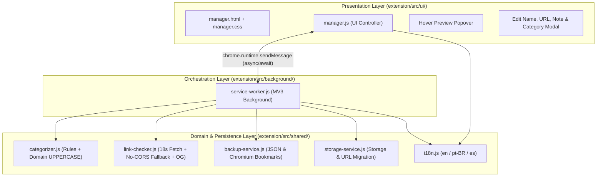

# PROJECT CHECKPOINT — Brave Bookmark Architect & Smart Organizer

**Data de Atualização:** 15/11/2026  
**Versão:** `1.1.0`  
**Status:** Funcional, Internacionalizado (`en` / `pt-BR` / `es`) e Testado

---

## 1. Objetivo Geral e Escopo

O **Brave Bookmark Architect & Smart Organizer** é uma extensão de navegador (**Manifest V3**) projetada para o **Brave Browser** e **Google Chrome** com o objetivo de automatizar a auditoria, organização, padronização de nomes, anotação e backup de favoritos, tomando como referência a base real de **265 links** do arquivo `Bookmarks` do usuário.

### Escopo Principal
1. **Percorrer e Testar Links com Alta Resiliência**: Validar assincronamente todos os favoritos com timeout de 18s, leitura de stream limitada a 5s e sonda secundária de fallback (`no-cors` + `origin` ping) para evitar falsos positivos em servidores lentos ou protegidos por WAF/Cloudflare.
2. **Padronização Automática de Nomes por Domínio (`UPPERCASE`)**: Definir por padrão o nome de cada favorito como o nome principal do domínio sem extensão e em letras maiúsculas (ex.: `https://www.meusite.com` → `MEUSITE`), preservando o título original completo nos metadados para exibição na prévia e na busca.
3. **Categorizar e Organizar na Barra de Favoritos**: Classificar cada favorito por domínio, palavras-chave e contexto de pasta, criando as pastas correspondentes diretamente na **Barra de Favoritos (`id: "1"`)** e movendo os links automaticamente.
4. **Edição Completa de Links e Nomes com Trava Contra Links Quebrados**: Permitir editar o Nome, o Link (URL), a Categoria e a Nota de Observação de qualquer favorito, validando a URL em tempo real ao clicar em Salvar e bloqueando o salvamento caso o link esteja quebrado/offline.
5. **Prévia ao Passar o Mouse (Hover Preview)**: Exibir um card flutuante acessível (`popover="hint"`) ao passar o mouse ou focar em qualquer favorito, apresentando título completo, descrição OpenGraph/meta, imagem de capa (`og:image`), status HTTP e a nota de observação do usuário.
6. **Internacionalização Nativa (`i18n`)**: Interface em **Inglês (`en`)** por padrão, com seletor instantâneo no cabeçalho para **Português Brasil (`pt-BR`)** e **Espanhol (`es`)**.
7. **Exportação e Importação (Backup)**: Exportar todos os favoritos enriquecidos em JSON e importar tanto backups gerados pelo plugin quanto o próprio arquivo `Bookmarks` nativo do Brave/Chrome.

---

## 2. Arquitetura Escolhida e Justificativa

Foi adotada uma **Arquitetura Modular Orientada a Serviços para WebExtensions (Manifest V3)**, isolando o pacote carregável da extensão dentro do diretório `extension/` (para evitar conflito com a restrição do Chromium que proíbe diretórios iniciados com `_` como `_docs` e `_testes` na raiz do manifesto):

- **Camada de Domínio e Serviços Compartilhados (`extension/src/shared/`)**: Módulos ES puros e 100% comentados em inglês (`categorizer.js`, `link-checker.js`, `backup-service.js`, `storage-service.js`, `i18n.js`).
- **Camada de Orquestração em Background (`extension/src/background/service-worker.js`)**: Service Worker efêmero que gerencia `chrome.bookmarks`, `chrome.storage`, `chrome.sidePanel`, `chrome.contextMenus` e `chrome.notifications`.
- **Camada de Apresentação (`extension/src/ui/`)**: Interface híbrida que funciona tanto no **Side Panel** quanto em uma aba de **Tela Cheia**, utilizando `<dialog closedby="any">` e `<div popover="hint">`.



---

## 3. Tecnologias e Versões Principais

| Camada | Tecnologia | Versão / Padrão |
| :--- | :--- | :--- |
| Plataforma de Extensão | Chrome / Brave Extensions | **Manifest V3** |
| Linguagem & Comentários | JavaScript (ES Modules, código e comentários padronizados em Inglês) | **ES2023+** |
| Internacionalização | Motor reativo `i18n.js` (`data-i18n*`) | **EN (Default), PT-BR, ES** |
| Interface & Componentes | HTML5 Nativo (`<dialog closedby="any">`, `popover="hint"`) + CSS3 | Baseline 2025/2026 + Fallbacks |
| Armazenamento | `chrome.storage.local` (10 MB) & `chrome.storage.session` | API Nativa MV3 |
| Testes Automatizados | Node.js Test Runner (`node:test` + `node:assert/strict`) | Node.js v20+ |

---

## 4. Estrutura de Pastas Atual

```text
/home/murilo/Projetos/dev/tools/bookmark_manager/
├── .gitignore                            # Protege o arquivo pessoal Bookmarks e artefatos locais
├── Bookmarks                             # Arquivo original de referência (ignorado no Git por privacidade)
├── package.json                          # Configuração ES Module e script de teste
├── README.md                             # Documentação completa em Inglês
├── _docs/
│   └── PROJECT_CHECKPOINT.md             # Este documento de checkpoint arquitetural
├── _testes/
│   └── unit/
│       └── bookmark-architect.test.js    # 6 suítes de testes unitários e de integração
└── extension/                            # <-- PASTA PARA CARREGAR NO BRAVE (brave://extensions)
    ├── manifest.json                     # Manifesto MV3 da extensão
    ├── icons/
    │   ├── icon-16.png                   # Ícone 16x16px
    │   ├── icon-48.png                   # Ícone 48x48px
    │   └── icon-128.png                  # Ícone 128x128px
    └── src/
        ├── background/
        │   └── service-worker.js         # Orquestrador MV3 (Scan, Organização, Validação no Save, Backup)
        ├── shared/
        │   ├── backup-service.js         # Exportação e importação (JSON e Chromium Bookmarks)
        │   ├── categorizer.js            # Categorização + extração de domínio em UPPERCASE
        │   ├── i18n.js                   # Dicionários e tradutor para en, pt-BR e es
        │   ├── link-checker.js           # Validador HTTP resiliente (18s + fallback no-cors) + OpenGraph
        │   └── storage-service.js        # Persistência e migração de metadados ao editar URLs
        └── ui/
            ├── manager.css               # Estilização Dark Mode inspirada no Brave Browser
            ├── manager.html              # Estrutura HTML do Side Panel / Dashboard
            └── manager.js                # Controlador de UI, seletor de idioma, hover preview e modal
```

---

## 5. Funcionalidades Implementadas

- [x] **Validação Resiliente de Links (`link-checker.js`)**:
  - Pool de 4 *workers* simultâneos com timeout principal de 18s e deadline separado de 5s para leitura de stream HTML.
  - Sonda secundária automática (`probeFallbackConnectivity`) em modo `no-cors` na URL e no `origin` quando uma requisição falha por bloqueio WAF/TLS.
  - Reconhecimento de códigos `400, 401, 403, 405, 406, 429, 503` como `restricted` (Servidor Ativo / Protegido).
- [x] **Padronização de Nome por Domínio em UPPERCASE (`extractDomainNameUppercase`)**:
  - Converte URLs como `https://www.meusite.com` em `MEUSITE`, removendo subdomínios genéricos (`www`, `app`, `dashboard`) e TLDs simples ou compostos (`.com`, `.com.br`, `.gov.br`).
  - Preserva nomes customizados quando o usuário edita manualmente o título (`customTitle: true`).
- [x] **Edição de Nome e Link com Validação antes de Salvar**:
  - Permite editar o título e a URL do favorito.
  - Testa o link antes de persistir: se estiver quebrado (`broken`), bloqueia o salvamento e exibe um banner de erro dentro do modal; se estiver válido, atualiza o favorito no navegador e migra os metadados da URL antiga para a nova (`migrateBookmarkMetadataUrl`).
- [x] **Internacionalização (`en`, `pt-BR`, `es`)**:
  - Inglês como idioma padrão da interface e seletor persistente no topo do painel.
- [x] **Organização na Barra de Favoritos (`id: "1"`), Prévia no Hover, Notas e Backup JSON**.

---

## 6. Modelos de Dados (Schema Resumido)

### 6.1. `chrome.storage.local` (`bm_metadata_by_url` & `bm_ui_language`)

```json
{
  "bm_ui_language": "en",
  "bm_metadata_by_url": {
    "https://www.agensi.io/": {
      "category": "AI",
      "customTitle": false,
      "originalTitle": "Agensi: The Skill Marketplace for AI Agents",
      "note": "Marketplace for AI agent skills",
      "status": "valid",
      "statusCode": 200,
      "error": null,
      "preview": {
        "pageTitle": "Agensi: The Skill Marketplace for AI Agents",
        "description": "Discover and integrate specialized skills for autonomous AI agents.",
        "image": "https://www.agensi.io/og-image.png"
      },
      "checkedAt": "2026-11-15T20:15:00.000Z",
      "updatedAt": "2026-11-15T20:15:00.000Z"
    }
  }
}
```

---

## 7. Regras de Negócio Importantes

1. **Nomenclatura Padrão em UPPERCASE**: Todo favorito exibe e recebe na Barra de Favoritos o nome do domínio sem extensão em maiúsculas (`MEUSITE`), a menos que o usuário defina explicitamente um nome diferente no modal de edição (`customTitle: true`).
2. **Trava de Qualidade no Salvamento de Edição**: Nenhum link editado é salvo se o `checkSingleUrl` retornar `LINK_STATUS.BROKEN`.
3. **Migração Transparente de Chave de URL**: Quando o usuário altera a URL de um favorito existente e ela passa na validação, `migrateBookmarkMetadataUrl` transfere notas, categoria e histórico para a nova URL e remove a chave órfã antiga.

---

## 8. Decisões Técnicas Relevantes

- **Sonda Dupla (`CORS GET` → `no-cors Fallback`)**: Extensões com `<all_urls>` fazem requisições com cabeçalhos de origem `chrome-extension://...`, que alguns WAFs (Cloudflare, Akamai, portais bancários/governamentais) rejeitam ou descartam. A sonda secundária em modo `no-cors` elimina falsos positivos mantendo a capacidade de extrair OpenGraph sempre que o servidor permite leitura.
- **Comentários e Código Padronizados em Inglês**: Todos os arquivos `.js`, `.html`, `manifest.json` e suíte de testes utilizam comentários e documentação JSDoc em inglês para manter padrão internacional no repositório GitHub.

---

## 9. Status de Segurança e Performance

- **Segurança (OWASP & LGPD)**:
  - Renderização 100% via `textContent` e criação programática de nós DOM (zero risco de XSS por títulos ou meta tags maliciosas).
  - Arquivo pessoal `Bookmarks` protegido no `.gitignore` para nunca vazar dados privados no repositório público.
- **Performance**:
  - Pool concorrente calibrado em 4 conexões simultâneas e leitura parcial de stream limitada a 48 KB / 5 segundos.

---

## 10. Próximos Passos Sugeridos

1. **Limpeza Automática de Parâmetros de Rastreamento (UTM Stripper)**: Opção para remover automaticamente `utm_source`, `utm_medium`, `gad_source` e `gbraid` das URLs ao organizar os favoritos.
2. **Detecção e Mesclagem de Favoritos Duplicados**: Painel dedicado para encontrar links repetidos em pastas diferentes.
3. **Verificação Periódica Silenciosa (`chrome.alarms`)**: Checagem agendada em background com relatório mensal de saúde dos links.
